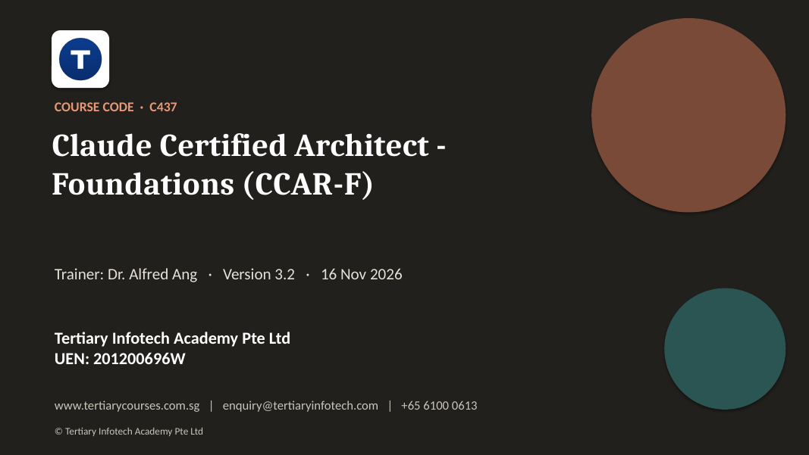

# Claude Certified Architect - Foundations Certification

Build reliable Claude-based systems with bounded agent loops, precise tool contracts, scoped Claude Code workflows, validated outputs, and evidence-aware reliability controls.

| Course detail | Information |
|---|---|
| Course code | `C437` |
| Duration | 2 days / 15 hours (9:30am – 5:30pm daily) |
| Programme | Non-WSQ |
| Courseware release | v2.0 (10 Oct 2026) |
| Registration | [View course details and register](https://www.tertiarycourses.com.sg/claude-certified-architect-foundations-certification.html) |

## Courseware preview



The v2.0 courseware uses the Claude house theme (Cambria headings, Calibri body, cream and ink with terracotta accents). It semantically maps the instructional frames to the certification blueprint and adds one editable field-pattern synthesis slide for every official exam task.

## About the course

This learner repository accompanies the Claude Certified Architect - Foundations Certification course. The programme develops architecture judgement for designing agentic systems with observable stopping conditions, reliable tools and MCP integrations, maintainable Claude Code configuration, structured-output validation, and human escalation backed by provenance.

## Learning outcomes

By the end of the course, learners should be able to:

- Design bounded agentic loops and multi-agent orchestration with explicit handoffs, state, and stop conditions.
- Engineer reliable tool and MCP integrations with precise schemas, structured errors, and least-privilege tool distribution.
- Configure Claude Code projects with scoped instructions, reusable skills, rules, plan mode, and CI/CD workflows.
- Produce validated structured outputs using explicit criteria, examples, batching, and review loops.
- Manage context, uncertainty, provenance, and human escalation in long-running AI systems.

## Topics covered

| Exam domain | Weight |
|---|---:|
| Agentic Architecture & Orchestration | 27% |
| Tool Design & MCP Integration | 18% |
| Claude Code Configuration & Workflows | 20% |
| Prompt Engineering & Structured Output | 20% |
| Context Management & Reliability | 15% |

## Labs

Each lab is self-contained, offline-first, and includes fixtures, runnable artifacts, acceptance checks, a verifier, and a PDF guide.

1. [Customer Support Resolution Agent](labs/lab-01-customer-support-agent/README.md)
2. [Claude Code Team Workspace](labs/lab-02-claude-code-workspace/README.md)
3. [Multi-Agent Research System](labs/lab-03-multi-agent-research/README.md)
4. [Developer Productivity Agent](labs/lab-04-developer-productivity-agent/README.md)
5. [Claude Code CI Review](labs/lab-05-claude-code-ci-review/README.md)
6. [Structured Data Extraction](labs/lab-06-structured-data-extraction/README.md)

Run a lab verifier from its folder:

```bash
python3 -B verify.py
```

## Public package

This repository contains the current courseware and the six learner-safe lab folders:

- [Trainer Slides v2.0 (PPTX)](courseware/C437-Claude-Certified-Architect-Foundations-Certification-Trainer-Slides-v2.0.pptx) and [PDF](courseware/C437-Claude-Certified-Architect-Foundations-Certification-Trainer-Slides-v2.0.pdf)
- [Learner Guide (DOCX)](courseware/LG-Claude-Certified-Architect-Foundations-Certification-v1.0.docx) and [PDF](courseware/LG-Claude-Certified-Architect-Foundations-Certification-v1.0.pdf)
- [Lesson Plan (DOCX)](courseware/LP-Claude-Certified-Architect-Foundations-Certification-v1.0.docx) and [PDF](courseware/LP-Claude-Certified-Architect-Foundations-Certification-v1.0.pdf)
- [Labs](labs/README.md)

Superseded versions are kept out of the repository.

## Reference acknowledgement

The original lab scenarios were informed by publicly available study projects from [Paul Larionov](https://github.com/paullarionov/claude-certified-architect), [Ade Regil](https://github.com/aderegil/claude-certified-architect), and [Daron Yondem](https://github.com/daronyondem/claude-architect-exam-guide).

## Public/private distribution boundary

This public repository contains learner-safe lab material only. Instructor reference screenshots, credentials, private build tooling, archives, and QA evidence are intentionally excluded.

Course content is provided by Tertiary Infotech Academy Pte Ltd (UEN 201200696W).
